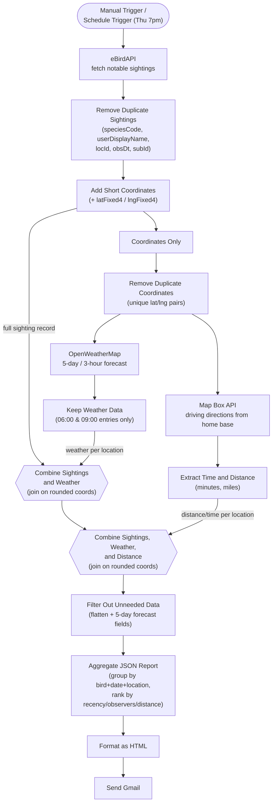

# eBird Rare Bird Alert

Standalone Node.js replacement for the `eBirdAgent.json` n8n workflow. No n8n installation or
instance required. Finds notable nearby bird sightings via the eBird API, enriches each with a
5-day weather forecast (OpenWeatherMap) and driving distance/time (Mapbox), groups and ranks
them, and emails an HTML report via Gmail.

## How it works

The pipeline fetches one batch of raw sightings, branches into two independent enrichment
lookups keyed by location, then rejoins everything before building and sending the report.



Step by step:

1. **Trigger** (`nodes/triggerManual.js`, `nodes/triggerSchedule.js`) — starts the run, either
   on demand (`node main.js`) or on the weekly cron tick (`node scheduler.js`).
2. **eBirdAPI** (`nodes/ebirdApi.js`) — fetches all "notable" sightings within `EBIRD_DIST_KM`
   of each point in `EBIRD_SEARCH_COORDS` (one API call per point, run in parallel; defaults to
   `HOME_LAT`/`HOME_LNG`) over the last `EBIRD_BACK_DAYS` days, and concatenates the results.
3. **Remove Duplicate Sightings** (`nodes/removeDuplicateSightings.js`) — drops exact repeat
   observations (same species/observer/location/date/checklist), including the same sighting
   returned by multiple searches whose radii overlap.
4. **Add Short Coordinates** (`nodes/addShortCoordinates.js`) — flattens each sighting and adds
   `latFixed4`/`lngFixed4` (coordinates rounded to 4 decimals), which become the join key used
   later to reattach weather and distance data. This is where the pipeline **branches**:
   - the full sighting record flows straight through to the first merge step, and
   - its coordinates are split off for the location-lookup branch below.
5. **Coordinates Only → Remove Duplicate Coordinates** (`nodes/coordinatesOnly.js`,
   `nodes/removeDuplicateCoordinates.js`) — reduces many sightings down to the handful of
   *unique* locations they occurred at, so weather/distance are each only fetched once per
   location, not once per sighting.
6. For each unique location, in parallel:
   - **OpenWeatherMap → Keep Weather Data** (`nodes/openWeatherMap.js`,
     `nodes/keepWeatherData6to9.js`) — pulls the 5-day/3-hour forecast and keeps only the
     06:00 and 09:00 entries for each of the next 5 days.
   - **Map Box API → Extract Time and Distance** (`nodes/mapBoxApi.js`,
     `nodes/extractTimeAndDistance.js`) — gets driving directions from `HOME_LAT`/`HOME_LNG` to
     the location, converting duration to minutes and distance to miles.
7. **Combine Sightings and Weather**, then **Combine Sightings, Weather, and Distance**
   (`nodes/combineSightingsAndWeather.js`, `nodes/combineSightingsWeatherDistance.js`) — this is
   where the branches **rejoin**: each individual sighting is matched back to its location's
   weather and driving data by comparing rounded coordinates, so a location visited by 5
   different birds gets the same weather/distance attached to all 5 sighting records.
8. **Filter Out Unneeded Data** (`nodes/filterOutUnneededData.js`) — flattens each joined record
   down to just the fields the report needs, including the nested `weatherNext5Days.day1..day5`
   forecast.
9. **Aggregate JSON Report** (`nodes/aggregateJsonReport.js`) — builds a nested report:
   species (alphabetical by common name) → location (nearest driving distance first; locations
   with no distance last) → observation date (most recent first). Each date has the max count,
   unique observers, and checklist links; each species has a summary (location count, nearest
   distance, last seen date). The report is also saved to
   `json_output/ebird-report-<timestamp>.json` (`nodes/saveJsonReport.js`).
10. **Format as HTML → Send Gmail** (`nodes/formatAsHtml.js`, `nodes/sendGmail.js`) — renders
    one card per species, with a section per location (distance, drive time, and forecast shown
    once) and a row per date, and sends it to `EMAIL_TO`.

## Project layout

Every node from the original n8n workflow has its own file under `nodes/`, named after the node
it replaces. `main.js` wires them together in the same order and along the same branches/merges
as the original workflow's connections.

```
main.js            # orchestrates the full pipeline, on demand
scheduler.js        # runs main.js on the original workflow's weekly cron schedule
nodes/
  triggerManual.js               "When clicking 'Execute workflow'"
  triggerSchedule.js             "Schedule Trigger"
  ebirdApi.js                    "eBirdAPI"
  removeDuplicateSightings.js    "Remove Duplicate Sightings"
  addShortCoordinates.js         "Add Short Coordinates"
  coordinatesOnly.js             "Coordinates Only"
  removeDuplicateCoordinates.js  "Remove Duplicate Coordinates"
  openWeatherMap.js              "OpenWeatherMap"
  keepWeatherData6to9.js         "Keep Weather Data From 6 am to 12 pm"
  mapBoxApi.js                   "Map Box API"
  extractTimeAndDistance.js      "Extract Time and Distance"
  combineSightingsAndWeather.js  "Combine Sightings and Weather"
  combineSightingsWeatherDistance.js  "Combine Sightings, Weather, and Distance"
  filterOutUnneededData.js       "Filter Out Unneeded Data"
  aggregateJsonReport.js         "Aggregate JSON Report"
  saveJsonReport.js              (new) saves the report JSON to json_output/
  formatAsHtml.js                "Format as HTML"
  sendGmail.js                   "Send a message" (Gmail)
```

## Setup

1. Install dependencies:
   ```
   npm install
   ```
2. Copy `.env.example` to `.env` and fill in every value:
   ```
   cp .env.example .env
   ```
   You need:
   - `EBIRD_API_TOKEN` — from https://ebird.org/api/keygen
   - `OWM_API_KEY` — from https://home.openweathermap.org/api_keys
   - `MAPBOX_API_KEY` — from https://account.mapbox.com/access-tokens/
   - `GMAIL_CLIENT_ID`, `GMAIL_CLIENT_SECRET`, `GMAIL_REFRESH_TOKEN`, `GMAIL_SENDER_EMAIL` — a
     Google Cloud OAuth2 client with Gmail API access, plus a refresh token for the account that
     should send the email (e.g. via https://developers.google.com/oauthplayground with your own
     client ID/secret)
   - `EMAIL_TO`, `HOME_LAT`, `HOME_LNG`, `EBIRD_DIST_KM`, `EBIRD_BACK_DAYS`, `CRON_TIMEZONE` all
     have defaults matching the original workflow's hardcoded values — only change them if you
     want different behavior.
   - `EBIRD_SEARCH_COORDS` (optional) — semicolon-separated `lat,lng` search centers, e.g.
     `37.4894467,-121.9370132;37.7749,-122.4194`. Defaults to `HOME_LAT`/`HOME_LNG`. Driving
     directions always start from `HOME_LAT`/`HOME_LNG` regardless of this list.

## Run on demand

```
node main.js
```

## Run on a schedule

The original "Schedule Trigger" fires weekly on Thursday at 7:00 PM (cron: `0 19 * * 4`).

**Option A — in-process scheduler (keep a terminal/process running):**
```
node scheduler.js
```
Set `CRON_TIMEZONE` in `.env` (e.g. `America/Los_Angeles`) if you want a specific timezone
instead of the machine's local time.

**Option B — OS-level scheduler (no long-running Node process needed):**

macOS/Linux (`crontab -e`):
```
0 19 * * 4 cd /path/to/ebird-rare-bird-alert && /usr/bin/node main.js >> run.log 2>&1
```

Windows (Task Scheduler), run once from an elevated PowerShell/cmd prompt:
```
schtasks /create /tn "eBird Rare Bird Alert" /tr "node C:\Work\git\ebird-rare-bird-alert\main.js" /sc weekly /d THU /st 19:00
```
(Or use the Task Scheduler GUI: Create Task → Trigger: Weekly, Thursday, 7:00 PM → Action: Start
a program, `node.exe`, with argument `C:\Work\git\ebird-rare-bird-alert\main.js`.)

## Assumptions and known differences from the original n8n workflow

- **Dedup defaults**: "Remove Duplicate Sightings" and "Remove Duplicate Coordinates" had no
  explicit `operation` set, so both are reproduced using n8n's default behavior (dedupe within
  the current run's items only — not persisted across runs).
- **Merge join mode**: both Merge nodes had no explicit `joinMode`, so they're reproduced as an
  inner join — a sighting is dropped from the report if no matching weather/distance record is
  found for its (rounded) coordinate. In practice this should never happen since weather and
  distance are always fetched for every unique coordinate present in the sightings.
- **Mapbox auth**: the original used an opaque n8n "custom auth" credential. This script assumes
  the standard Mapbox `access_token` query parameter. If your original credential sent it as a
  header instead, adjust `nodes/mapBoxApi.js`.
- **Mapbox `depart_at`**: the original hardcoded a stale test timestamp
  (`2025-10-26T06:30`) unrelated to the actual schedule. It's dropped here, so Mapbox uses
  live/typical traffic instead of a specific future departure. See the `TODO` in
  `nodes/mapBoxApi.js` if you want traffic-aware timing for a specific day/time.
- **day1 weather `windSpeed`**: the original "Filter Out Unneeded Data" node has a latent bug
  where day1 never gets a `windSpeed` value (a misnamed assignment meant for day1 gets
  overwritten by the real day2 assignment). This is reproduced as-is in
  `nodes/filterOutUnneededData.js`, with a comment showing how to fix it if desired.
- **No retries/fallbacks added**: nothing in the source JSON configured `retryOnFail` or
  `continueOnFail`, so none was added here — any API error aborts the run, matching n8n's
  default behavior.
- **Triggers**: both the manual and weekly-schedule triggers run natively on a local machine, so
  no substitute/polling mechanism was needed.
